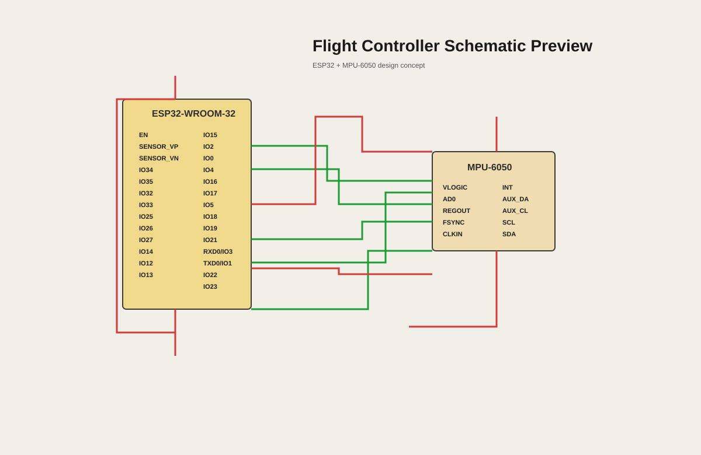

# half-life-project
Everything I do for half life project

## Flight controller schematic
The repository now includes the KiCad schematic for the ESP32 + MPU-6050 flight controller design.

- Schematic file: [Flight coltroller.kicad_sch](./Flight%20coltroller.kicad_sch)
- Project status: active design / prototype concept

## Hardware overview
- ESP32-WROOM-32 module
- MPU-6050 inertial measurement unit
- Shared ground and power rails
- UART / I2C-style signal routing between the controller and IMU

This README can be expanded with photos, test notes, wiring details, and firmware progress as the project develops.
